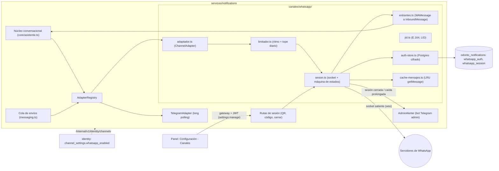
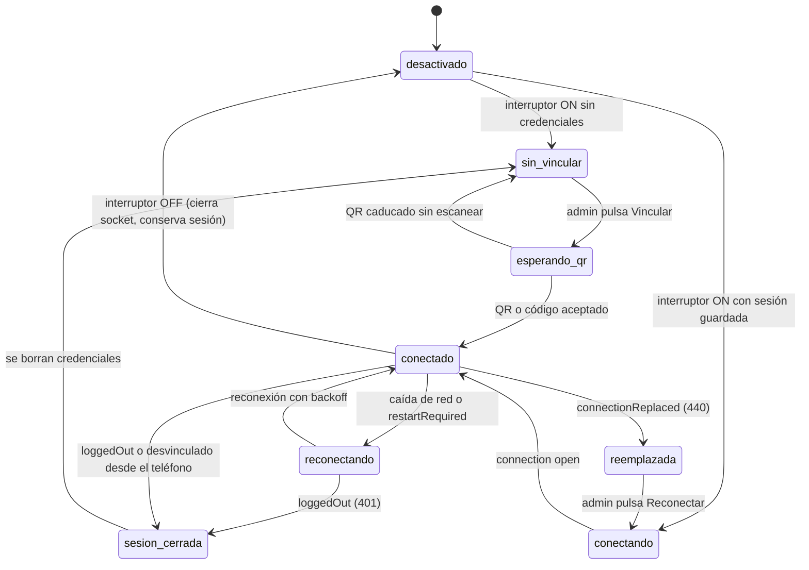

# Plan de implementación — WhatsApp por Baileys en lugar de Meta Cloud API

- **Fecha:** 2026-10-29 · **Estado:** borrador para revisión · **Alcance:** servicio `notifications`,
  `identity` (panel de canales), `contracts`, `gateway`, `web`, instaladores, herramientas y documentación.
- **Decisión de partida (del usuario):** se sustituye la integración con **WhatsApp Cloud API**
  (oficial, webhook HTTPS) por **Baileys** (cliente no oficial de WhatsApp Web, socket saliente).
  Se aceptan los riesgos —bloqueo del número, cambios del protocolo— porque el **volumen de mensajes
  será bajo**.

---

## 1. Resumen

| Hoy (Cloud API) | Objetivo (Baileys) |
| --- | --- |
| Meta **empuja** por webhook: exige HTTPS público (túnel de Cloudflare), `verify_token` y `app_secret` | El servicio **abre un socket saliente** (como WhatsApp Web): no hay ruta pública ni túnel |
| 4 secretos (`WHATSAPP_TOKEN`, `PHONE_ID`, `VERIFY_TOKEN`, `APP_SECRET`) + `API_BASE` | Ningún token: una **sesión vinculada por QR** (o código de emparejamiento) que se guarda **cifrada en la base** |
| Botones interactivos (hasta 3) | **Sin botones** fiables: el núcleo ya numera las opciones (`sendAdapted`, ADR 0029 regla 2) |
| Fuera de la ventana de 24 h, solo **plantillas aprobadas** | Sin ventana ni plantillas de Meta: se envía el texto del catálogo propio |
| Adjuntos: subida a `/media` + envío por id | Adjuntos directos (`document: Buffer`) |
| El adaptador se enciende si hay 4 credenciales | El adaptador se enciende con un **interruptor** del panel (`whatsappEnabled`) y queda «sin vincular» hasta escanear el QR |

**Qué no cambia:** el id de canal sigue siendo **`whatsapp`** (contratos, `CHECK` de las bases,
`patient_channels`, reporting, scheduling). Tampoco cambian el núcleo conversacional, la cola de
envíos, las plantillas editables, el `.ics`, la idempotencia por `(canal, eventoId)`, el modo test
ni Telegram.

---

## 2. Inventario de la implementación actual (lo que hay que tocar)

| Capa | Archivo | Qué contiene hoy de Cloud API |
| --- | --- | --- |
| Adaptador | [`services/notifications/src/canales/whatsapp.ts`](../../../services/notifications/src/canales/whatsapp.ts) | Graph API (`fetch`), firma `x-hub-signature-256`, `toInboundMessages`, verificación `hub.challenge`, subida de medios, botones interactivos |
| Registro | [`services/notifications/src/canales/index.ts`](../../../services/notifications/src/canales/index.ts) | Enciende WhatsApp si hay `whatsappCredentials`; expone `webhooks` |
| Contrato del adaptador | [`services/notifications/src/canales/adaptador.ts`](../../../services/notifications/src/canales/adaptador.ts) | `sendAdapted` (no cambia), comentario «Telegram, WhatsApp…» |
| Kit de conformidad | [`services/notifications/src/canales/conformidad.ts`](../../../services/notifications/src/canales/conformidad.ts) | `casoWhatsApp` (falso `fetch` de Meta, webhook firmado) |
| Pruebas | [`whatsapp.test.ts`](../../../services/notifications/src/canales/whatsapp.test.ts), [`modo-test.test.ts`](../../../services/notifications/src/canales/modo-test.test.ts), [`config.test.ts`](../../../services/notifications/src/config.test.ts), [`conformidad.test.ts`](../../../services/notifications/src/canales/conformidad.test.ts) | Credenciales de Meta, payloads de webhook |
| Configuración | [`services/notifications/src/config.ts`](../../../services/notifications/src/config.ts) | `WHATSAPP_*` en el esquema, `applyChannelCredentials`, `syncChannelFields`, `channelSignature` |
| Arranque | [`services/notifications/src/index.ts`](../../../services/notifications/src/index.ts) | Recarga en caliente de canales; log «Canal con webhook activo» |
| Rutas | [`services/notifications/src/routes.ts`](../../../services/notifications/src/routes.ts) | `GET/POST /api/v1/notifications/webhook/:canal`, `rawBodyOf`, `headersOf`, link-code solo `t.me`, prueba de canal |
| Servidor | [`services/notifications/src/server.ts`](../../../services/notifications/src/server.ts) | Parser JSON que guarda `rawBody` (solo existe para la firma de Meta) |
| Mensajería | [`services/notifications/src/messaging.ts`](../../../services/notifications/src/messaging.ts) | Comentarios de «WhatsApp admite hasta tres botones»; envío del aviso con `.ics` |
| Asistente | [`services/notifications/src/core/asistente.ts`](../../../services/notifications/src/core/asistente.ts) | `linkByCode` solo pensado para `t.me/<bot>?start=` |
| Contratos | [`packages/contracts/src/domain/channel.ts`](../../../packages/contracts/src/domain/channel.ts) | `plantillasAprobadas` («WhatsApp Cloud API»), `WebhookRequest/Response`, `detectIntent` sin argumento en canales sin comandos |
| Contratos | [`packages/contracts/src/domain/settings.ts`](../../../packages/contracts/src/domain/settings.ts) | `DEFAULT_WHATSAPP_API_BASE`, `whatsappToken/PhoneId/VerifyToken/AppSecret/ApiBase` en entrada, vista y credenciales |
| Contratos | [`packages/contracts/src/domain/notification.ts`](../../../packages/contracts/src/domain/notification.ts), [`domain/audit.ts`](../../../packages/contracts/src/domain/audit.ts) | `channelStatusSchema` (sin detalle de sesión); acciones de auditoría |
| Eventos | [`packages/events/src/topics.ts`](../../../packages/events/src/topics.ts) | Tópicos `notifications.*` del outbox |
| Identity | [`services/identity/src/settings/channel-service.ts`](../../../services/identity/src/settings/channel-service.ts), [`db/schema.ts`](../../../services/identity/src/db/schema.ts), [`routes/settings-routes.ts`](../../../services/identity/src/routes/settings-routes.ts), [`settings.integration.test.ts`](../../../services/identity/src/settings.integration.test.ts) | Columnas `whatsapp_*_enc`, `whatsapp_phone_id`, `whatsapp_api_base` (migración `0005_configuracion`) |
| Gateway | [`apps/gateway/src/auth-guard.ts`](../../../apps/gateway/src/auth-guard.ts), [`routes.ts`](../../../apps/gateway/src/routes.ts), [`proxy.test.ts`](../../../apps/gateway/src/proxy.test.ts) | Prefijo público `/api/v1/notifications/webhook/`; descripción de `/api/v1/notifications` |
| Web | [`apps/web/src/components/config/CanalesSection.tsx`](../../../apps/web/src/components/config/CanalesSection.tsx), [`apps/web/src/lib/i18n.ts`](../../../apps/web/src/lib/i18n.ts), [`apps/web/src/lib/audit.ts`](../../../apps/web/src/lib/audit.ts) | Formulario de Token / Phone ID / Verify token / App secret / Base de la API; etiquetas de auditoría |
| Web | [`BotStatusCard.tsx`](../../../apps/web/src/components/notifications/BotStatusCard.tsx), [`PatientChannelCard.tsx`](../../../apps/web/src/components/notifications/PatientChannelCard.tsx) | Estado centrado en Telegram; QR de vinculación solo `t.me`; clave de fila `patientId` única y `@usuario` fijo |
| Instaladores | [`infra/fedora/instalar/instalar.sh`](../../../infra/fedora/instalar/instalar.sh), [`infra/fedora/instalar/aprovisionar.mjs`](../../../infra/fedora/instalar/aprovisionar.mjs), [`infra/windows/instalar/instalar.ps1`](../../../infra/windows/instalar/instalar.ps1), [`infra/fedora/ensayo-despliegue.sh`](../../../infra/fedora/ensayo-despliegue.sh) | Preguntas y banderas `--whatsapp-*`, plantillas de `notifications.env`, reconciliación `--clave-almacen` |
| Herramientas | [`tools/audit-conexiones.mjs`](../../../tools/audit-conexiones.mjs), [`tools/plantillas-fedora.mjs`](../../../tools/plantillas-fedora.mjs), [`tools/e2e-config.mjs`](../../../tools/e2e-config.mjs), [`tools/smoke-notifications.mjs`](../../../tools/smoke-notifications.mjs) | Lista de variables `WHATSAPP_*`, guardia `fedora:check`, campos del panel, comprobación del webhook público |
| Entorno | [`.env.example`](../../../.env.example), [`services/notifications/.env.example`](../../../services/notifications/.env.example) | Bloque «WhatsApp Cloud API» |
| Docs | [`README.md`](../../../README.md), [`docs/SEGURIDAD_SECRETOS.md`](../../SEGURIDAD_SECRETOS.md), [`docs/COMANDOS.md`](../../COMANDOS.md), [`docs/PLAN_MAESTRO_FASES.md`](../../PLAN_MAESTRO_FASES.md), `infra/*/INSTALL.md`, `infra/*/RUNBOOK.md`, [ADR 0029](../0029-nucleo-conversacional-y-adaptadores.md), [ADR 0060](../0060-configuracion-de-la-aplicacion.md), [índice de ADR](../README.md), [`CHANGELOG.md`](../../../CHANGELOG.md) | Cloud API, webhook, túnel, credenciales |

**No hace falta tocar** (el id `whatsapp` se conserva): `services/scheduling`, `services/reporting`,
`packages/testing`, las migraciones antiguas, `enums.ts`/`CHANNELS`, ni los textos genéricos
«Telegram o WhatsApp» de la web.

> [!NOTE]
> El propio adaptador dice «Faltan las credenciales para activarlo». **Hay que comprobar en
> producción** si existe alguna fila `patient_channels.channel = 'whatsapp'` o credenciales en
> `channel_settings`. Lo más probable es que Cloud API **nunca haya llegado a estar en marcha**, y en
> ese caso no hay datos que migrar (ver §8).

---

## 3. Decisiones de diseño

Cada una lleva una recomendación. Las que están marcadas con ❓ se repiten en §11 para que las confirmes.

| # | Decisión | Recomendación |
| --- | --- | --- |
| **D1** | ¿Id de canal nuevo (`whatsapp_web`) o se reutiliza `whatsapp`? | **Reutilizar `whatsapp`**. Evita migraciones de `CHECK` en scheduling/reporting/notifications y conserva vínculos y conversaciones. El proveedor es un detalle del adaptador (ADR 0029). |
| **D2** | ¿Se conserva el adaptador Cloud API como alternativa? ❓ | **Se elimina**: queda en el historial de git y la etiqueta de la versión anterior permite recuperarlo. Mantener dos proveedores duplica configuración, panel y pruebas para un caso que no se usa. |
| **D3** | ¿Dónde vive la sesión (credenciales Signal)? | En la base **`odonto_notifications`**, en una tabla `whatsapp_auth` **cifrada con `STORAGE_ENCRYPTION_KEY`** (AES-256-GCM de `@odontocrm/storage`, igual que `channel_settings`). **No** en `useMultiFileAuthState`, que guarda ficheros sueltos y no se recomienda para producción. Así entra en el respaldo nocturno sin tocar los scripts. |
| **D4** | ¿Cómo se vincula el número? | **QR desde el panel** (Configuración → Canales, solo `admin`), refrescado por *polling*. Como alternativa, **código de emparejamiento** (`requestPairingCode(teléfono)`) y una **CLI** (`npm run whatsapp:vincular`) que pinta el QR en la terminal, para instalaciones sin navegador. |
| **D5** | ¿Cómo se enciende el canal? | Un interruptor `whatsappEnabled` en `channel_settings` (panel), con `WHATSAPP_ENABLED` del `.env` como respaldo (misma semántica que el resto: la base manda, ADR 0060). Encendido y sin sesión → estado `sin_vincular`. |
| **D6** | Formato de la `direccion` | **Dígitos del número en formato E.164 sin `+`** (`584141234567`), igual que el `wa_id` de Cloud API, para que las filas existentes sigan valiendo. Si WhatsApp solo entrega un **LID** (`…@lid`, Baileys v7) y no se conoce el número, se guarda el **JID completo** (`123…@lid`). Al enviar: dígitos → `<dígitos>@s.whatsapp.net`; con `@` → tal cual. |
| **D7** | Botones | `capacidades.botones = false`. Los mensajes interactivos no son fiables en clientes no oficiales. El núcleo ya numera las opciones y el aviso de cita ya invita a escribir «confirmar»/«cancelar» (ADR 0052/0053). |
| **D8** | Política de contacto (anti-bloqueo) ❓ | **Solo opt-in**: se escribe únicamente a quien escribió antes al número o se vinculó con código. **No** se escribe en frío al teléfono de la ficha del paciente. Es la mitigación de bloqueo más eficaz. |
| **D9** | Ritmo de envío | Limitador **global y serial** en el adaptador: intervalo mínimo con *jitter*, «escribiendo…» proporcional al largo del texto y **tope diario**. Si se supera el tope o no hay conexión, el aviso se **difiere sin gastar intentos** (mismo mecanismo que «consultorio sin configurar»). |
| **D10** | Historial y privacidad | `syncFullHistory: false` y `shouldSyncHistoryMessage: () => false`. **No** se guardan chats: solo el estado de la conversación del asistente, como hoy. Para los reintentos de cifrado (`getMessage`) se usa una caché en memoria (LRU) de los últimos mensajes enviados. |
| **D11** | Mensajes que se ignoran | Grupos (`@g.us`), estados (`status@broadcast`), difusiones, canales (`@newsletter`), `fromMe`, mensajes de protocolo y reacciones, y los `messages.upsert` que no sean `type: 'notify'` (sincronización). Los medios del paciente (audio, imagen) llegan con `texto: null` y el núcleo repite el paso. |
| **D12** | ¿El número lo usa también una persona desde el teléfono? ❓ | Recomendado: **número dedicado al bot** (SIM propia + WhatsApp Business en un teléfono del consultorio). Opcional (fase posterior): si alguien escribe a mano desde el teléfono (`fromMe` que no salió del socket), **pausar el bot en ese chat** N horas. |
| **D13** | Vinculación por código en WhatsApp | Arreglar el hueco actual: `link-code` devuelve además `https://wa.me/<número>?text=VINCULAR%20<código>` con su QR, y `detectIntent` acepta **intención + argumento** en canales sin comandos (`vincular ABC123`, `start ABC123`, `estado #000123`). |
| **D14** | Ruta pública | **Se elimina** el webhook y su excepción en el gateway. Las únicas rutas públicas pasan a ser salud, el ciclo de login y la verificación de documentos. |
| **D15** | Recarga en caliente | La recarga de canales cada minuto (ADR 0060) **no debe** cerrar el socket cuando solo cambia Telegram. El adaptador de WhatsApp se conserva entre reconstrucciones mientras `whatsappEnabled` no cambie. |
| **D16** | Orden de preferencia del canal ❓ | Hoy los avisos van **primero por Telegram y luego por WhatsApp** (`appointments.ts`, `messaging.ts`). Se mantiene salvo que quieras que WhatsApp pase primero. |

---

## 4. Arquitectura objetivo



**Estados de la sesión** (los ve el panel, la bandeja y el bot de administración):



Reglas de la máquina de estados:

- **`restartRequired` (515)**, `connectionClosed`, `connectionLost` y `timedOut` → reconectar con *backoff*
  exponencial (1 s → `WHATSAPP_RECONNECT_MAX_DELAY_MS`), sin intervención.
- **`loggedOut` (401)** → borrar `whatsapp_auth`, estado `sesion_cerrada`, **aviso inmediato** al
  administrador. **No** reintentar en bucle.
- **`connectionReplaced` (440)** → otra instancia abrió la misma sesión (por ejemplo desarrollo y
  producción con el mismo número). **No** reconectar sola (pelearían): estado `reemplazada` + aviso.
- **`badSession` / `multideviceMismatch`** → tratar como sesión cerrada (re-vincular).
- Caída que dura más de `WHATSAPP_ALERT_AFTER_MINUTES` → aviso al administrador. Al volver, aviso de «restablecido».

---

## 5. Riesgos y mitigaciones

| Riesgo | Impacto | Mitigación |
| --- | --- | --- |
| **Bloqueo del número** por uso no oficial | El canal deja de funcionar | Opt-in estricto (D8), ritmo y tope diario (D9), «escribiendo…», número dedicado (D12), sin difusiones. **Plan B ya existente**: el aviso cae a «notificación manual pendiente» (ADR 0008) y Telegram sigue intacto. Runbook de «número bloqueado». |
| **Cambios del protocolo** que rompen Baileys | Mensajes que no salen | **Versión exacta fijada** (sin `^`), actualización **manual** con su prueba de humo, `fetchLatestBaileysVersion()` al conectar, alerta al administrador cuando el estado no es `conectado`. |
| **LID** (Baileys v7: identificadores anónimos `@lid`) | Dirección sin número; vínculos duplicados | D6. Guardar el mapeo PN↔LID que entrega Baileys (claves `lid-mapping` del auth state, evento `lid-mapping.update`) y preferir el PN alternativo del mensaje cuando venga. Pruebas con *fixtures* de ambos formatos. |
| **Teléfono principal apagado** muchos días | WhatsApp desvincula los dispositivos enlazados (~14 días sin conexión del teléfono) | Runbook: el teléfono del consultorio cargado y con datos o wifi. La alerta de `sesion_cerrada` llega al bot de administración. |
| **Dependencia de git en `npm ci`** (Baileys tira de `libsignal` desde GitHub en algunas versiones) | La instalación offline o en Windows falla | Verificarlo en la **Fase 0**. Si aplica: exigir git en `10-preparar.*` o *vendorizar* el tarball en `package-lock`. |
| **Robo de la sesión** (equivale a la cuenta de WhatsApp) | Alguien lee o envía como el consultorio | Cifrado en reposo (D3), sin rutas públicas, QR y cierre solo para `admin`, auditoría de vinculación y cierre, documentado en `SEGURIDAD_SECRETOS.md`. |
| **Restaurar un respaldo antiguo** | Claves Signal desfasadas: errores de descifrado | Runbook de recuperación: si tras restaurar la sesión no conecta, «Cerrar sesión» y volver a vincular (1 minuto). |
| **Dos instancias con la misma sesión** | `connectionReplaced` en bucle | Regla del 440 (§4) + documentar: **nunca** el mismo número en desarrollo y producción (en desarrollo, otro número o modo test). `notifications` sigue siendo instancia única (PM2 `fork`, ADR 0008). |
| **Términos de servicio de WhatsApp** | Riesgo legal y de cuenta | Aceptado por el usuario. Queda escrito en el ADR. |

---

## 6. Fases de implementación

Cada fase termina con `npm run verify` en verde, sus pruebas nuevas y **commits atómicos** (convención
del repo). Las fases 1 a 5 se pueden hacer en una rama `feat/whatsapp-baileys`. La 7 (documentación)
se va llenando en paralelo, pero **el ADR se escribe en la Fase 0**, antes del código.

### Fase 0 — Validación técnica (spike) y ADR

**Objetivo:** confirmar los supuestos con un número de prueba antes de tocar el producto.

- [ ] Script desechable `docs/adr/plan_wa_baileys/spike/` (fuera de `services/`, no entra en el build)
      que: vincula por QR y por código, recibe texto, envía texto y un `.ics` (`text/calendar`), se
      reconecta tras cortar la red y detecta `loggedOut` al desvincular desde el teléfono.
- [ ] Fijar **paquete oficial y versión exacta** (`@whiskeysockets/baileys`, rama 7.x ESM-only). Anotar
      requisitos: Node ≥ 20 (el repo exige ≥ 22.9 ✔), ESM (`notifications` ya es `"type": "module"` ✔) y
      que Baileys 7.x desactiva los ACKs automáticos de entrega por defecto para reducir bloqueos (no reactivarlos).
- [ ] Comprobar si `npm ci` necesita **git** (dependencia `libsignal`) en Fedora **y en Windows** con el
      instalador de producción.
- [ ] Ver cómo llegan los entrantes con **LID** y qué campo trae el número alternativo en la versión elegida.
- [ ] Comprobar en Android **e iOS** que el `.ics` enviado como documento abre el calendario.
- [ ] Medir cuántas claves escribe la sesión (tamaño de `whatsapp_auth`) para dimensionar la tabla.
- [ ] Revisar en producción si hay filas `whatsapp` en `patient_channels` o credenciales en `channel_settings`.
- [ ] **Escribir el ADR 0072** (ver §7) en estado *propuesta*.

**Criterio de salida:** spike funcionando, versión fijada, riesgos de instalación resueltos y ADR 0072 revisado.

### Fase 1 — Contratos y configuración

**Objetivo:** que los tipos y la configuración hablen de Baileys sin romper nada todavía.

`packages/contracts`
- [ ] [`domain/channel.ts`](../../../packages/contracts/src/domain/channel.ts)
  - Comentarios de `ChannelCapabilities`, `InboundMessage.direccion` («dígitos E.164 o JID `@lid`»),
    `OutboundMessage.plantilla` y `ChannelAdapter` (WhatsApp ya **no** usa webhook).
  - `plantillasAprobadas`: se conserva como capacidad genérica, documentada como «ningún canal actual la usa».
  - `WebhookRequest/Response` y `ChannelAdapter.webhook?`: **se conservan** como interfaz genérica
    para canales futuros (coste nulo). El comentario dirá que hoy no hay ningún canal que lo implemente.
  - **`detectIntent`** (D13): en canales sin comandos, si no hay coincidencia exacta, probar
    *«frase de intención» + argumento* solo para las intenciones que lo admiten (`start`, `estado`,
    `cancelar`). Añadir la frase `vincular` a `start`. Pruebas en `channel.test.ts`.
- [ ] [`domain/settings.ts`](../../../packages/contracts/src/domain/settings.ts)
  - Eliminar `DEFAULT_WHATSAPP_API_BASE` y `channelApiBaseInput` (si nadie más lo usa).
  - Entrada, vista y credenciales: **quitar** `whatsappToken`, `whatsappPhoneId`, `whatsappVerifyToken`,
    `whatsappAppSecret` y `whatsappApiBase`. **Añadir** `whatsappEnabled: boolean` (entrada opcional).
  - `channelTestInputSchema`: el `destino` de WhatsApp acepta número local o E.164.
  - Actualizar `settings.test.ts`.
- [ ] [`domain/notification.ts`](../../../packages/contracts/src/domain/notification.ts)
  - `channelStatusSchema`: añadir `detalle: z.string().nullable().optional()` (estado de la sesión legible).
  - Nuevo bloque **«Sesión de WhatsApp»**: `WHATSAPP_SESSION_STATES`, `whatsappSessionViewSchema`
    (`estado`, `numero`, `nombre`, `qrDataUrl?`, `qrExpiraEn?`, `pairingCode?`, `conectadoDesde?`,
    `ultimaDesconexion?`, `motivo?`), `whatsappPairInputSchema` (`metodo: 'qr' | 'codigo'`, `telefono?`).
  - `linkCodeSchema`: añadir `whatsappLink?` y `whatsappQrDataUrl?`.
- [ ] Nuevo helper puro en contratos, `domain/phone.ts`: `toE164Digits(texto, prefijoPorDefecto)`
      (`0414-1234567` → `584141234567`), con pruebas.

`services/notifications`
- [ ] [`config.ts`](../../../services/notifications/src/config.ts): quitar `WHATSAPP_TOKEN/PHONE_ID/VERIFY_TOKEN/APP_SECRET/API_BASE` y añadir:

  | Variable | Por defecto | Para qué |
  | --- | --- | --- |
  | `WHATSAPP_ENABLED` | `false` | Respaldo del interruptor del panel |
  | `WHATSAPP_SESSION_ID` | `principal` | Clave de la sesión en `whatsapp_auth` |
  | `WHATSAPP_DEFAULT_COUNTRY_CODE` | `58` | Normalizar números locales |
  | `WHATSAPP_MIN_SEND_INTERVAL_MS` | `4000` | Ritmo mínimo entre envíos |
  | `WHATSAPP_SEND_JITTER_MS` | `2000` | Aleatoriedad añadida al intervalo |
  | `WHATSAPP_DAILY_SEND_CAP` | `150` | Tope diario de mensajes salientes |
  | `WHATSAPP_TYPING` | `true` | Simular «escribiendo…» |
  | `WHATSAPP_RECONNECT_MAX_DELAY_MS` | `300000` | Techo del *backoff* |
  | `WHATSAPP_ALERT_AFTER_MINUTES` | `15` | Caída que dispara aviso al administrador |
  | `WHATSAPP_LOG_LEVEL` | `warn` | Nivel del logger que se pasa a Baileys |
  | `STORAGE_ENCRYPTION_KEY` | — | **Nuevo en este servicio**: cifra la sesión |

  - `applyChannelCredentials`, `syncChannelFields` y `channelSignature`: cambiar los 5 campos por `WHATSAPP_ENABLED`.
  - Nueva `whatsappMode(config)`: `'desactivado' | 'activo'` (siempre `desactivado` en **modo test**, ADR 0020).
  - Actualizar `config.test.ts`.

`services/identity`
- [ ] Migración **`0008_whatsapp_baileys`** (SQL-first, ADR 0014): `ALTER TABLE channel_settings ADD COLUMN
      whatsapp_enabled boolean NOT NULL DEFAULT false`. **Las columnas viejas no se borran todavía**
      (la Fase 8 las elimina), así que se puede volver atrás sin perder nada.
- [ ] [`db/schema.ts`](../../../services/identity/src/db/schema.ts): añadir `whatsappEnabled` y marcar las
      columnas `whatsapp_*` antiguas como `@deprecated`, sin leerlas ni escribirlas.
- [ ] [`settings/channel-service.ts`](../../../services/identity/src/settings/channel-service.ts): leer y escribir
      `whatsappEnabled`, quitar los secretos de WhatsApp de `readChannelCredentials`, `readChannelView` y
      `updateChannelSettings`.
- [ ] [`routes/settings-routes.ts`](../../../services/identity/src/routes/settings-routes.ts): lista de campos
      auditables (líneas 62-66) → `whatsappEnabled`.
- [ ] [`settings.integration.test.ts`](../../../services/identity/src/settings.integration.test.ts).

**Criterio de salida:** compila todo el monorepo con los contratos nuevos. Las pruebas de identity y contracts pasan.

### Fase 2 — Persistencia de la sesión

**Objetivo:** un *auth state* de Baileys sobre Postgres, cifrado y transaccional.

- [ ] Dependencia `@odontocrm/storage` en `services/notifications/package.json` (para `encryptBlob` y `decryptBlob`).
- [ ] Migración **`0007_sesion_whatsapp`** en `services/notifications/migrations/`:
  ```sql
  CREATE TABLE whatsapp_auth (
    session_id text NOT NULL,
    categoria  text NOT NULL,   -- 'creds' | 'pre-key' | 'session' | 'sender-key' | 'app-state-sync-key' | 'lid-mapping' | 'device-list' | 'tctoken' | …
    clave      text NOT NULL,   -- id de la clave ('' para creds)
    valor      text NOT NULL,   -- 'enc:<base64>' o 'plain:<json>' (sin clave de almacén, solo en desarrollo)
    updated_at timestamptz NOT NULL DEFAULT now(),
    PRIMARY KEY (session_id, categoria, clave)
  );
  CREATE TABLE whatsapp_session (
    session_id text PRIMARY KEY,
    estado text NOT NULL,
    numero text, nombre text,
    vinculado_en timestamptz, conectado_desde timestamptz,
    ultima_desconexion timestamptz, motivo text,
    envios_hoy integer NOT NULL DEFAULT 0, envios_dia date,
    updated_at timestamptz NOT NULL DEFAULT now()
  );
  ```
  Más su *snapshot* de drizzle y el `_journal.json`. Comprobarla con `tools/verify-migrations.mjs`.
- [ ] [`db/schema.ts`](../../../services/notifications/src/db/schema.ts): tablas `whatsappAuth` y `whatsappSession`.
- [ ] **Nuevo** `canales/whatsapp/auth-store.ts` → `usePostgresAuthState(db, sessionId, key)`:
  - `creds`: si no hay fila, `initAuthCreds()`. Se serializa con `BufferJSON.replacer` y se lee con `BufferJSON.reviver`.
  - `keys.get(tipo, ids)`: lectura en lote. Para `app-state-sync-key`, rehidratar con `proto.Message.AppStateSyncKeyData.fromObject`.
  - `keys.set(data)`: **una transacción** (upsert de los valores, delete de los `null`).
  - `saveCreds()`, `clear()` (cerrar sesión) y envoltura con `makeCacheableSignalKeyStore`.
  - Cifrado igual que `channel-service.ts` (`enc:` / `plain:`), con un aviso en el log si no hay clave.
- [ ] Pruebas de integración (`auth-store.integration.test.ts`): ida y vuelta de `Buffer`, transacción
      atómica, borrado, cifrado en reposo (la columna no contiene el JSON en claro) y error claro si
      la fila está cifrada y falta la clave.

**Criterio de salida:** el *store* pasa sus pruebas contra Postgres real (`npm run test:integration`).

### Fase 3 — Adaptador Baileys

**Objetivo:** el `ChannelAdapter` nuevo, que pasa el kit de conformidad y sustituye al de Cloud API.

Estructura nueva en `services/notifications/src/canales/whatsapp/`:

| Archivo | Responsabilidad |
| --- | --- |
| `index.ts` | `createWhatsAppChannel({ config, db, logger, alertas, makeSocket? })` → `{ adapter, sesion }` |
| `sesion.ts` | Ciclo del socket: `makeWASocket({ auth, logger, browser, markOnlineOnConnect: false, syncFullHistory: false, shouldSyncHistoryMessage: () => false, getMessage, version })`, eventos `connection.update`, `creds.update`, `messages.upsert` y `lid-mapping.update`, máquina de estados (§4), *backoff*, `pair(metodo, telefono?)`, `logout()`, `restart()` y `estado()`. **`makeSocket` se inyecta** para poder probarlo sin red. |
| `entrantes.ts` | `toInboundMessage(WAMessage)`: filtros (D11), desenvolver con `normalizeMessageContent`, texto de `conversation` / `extendedTextMessage.text` / pie de foto, `eventoId = key.id`, `usuario = pushName`, `recibidoEn` desde `messageTimestamp`, `direccion` según D6. Función pura. |
| `jid.ts` | `direccionDesdeJid`, `jidDesdeDireccion`, `esLid`, uso de `toE164Digits`. Funciones puras. |
| `limitador.ts` | Cola serial con intervalo mínimo + *jitter*, `composing` → espera según el largo → `paused`, contador diario persistido en `whatsapp_session`. Lanza `CanalNoDisponibleError` o `CanalSaturadoError` con `reintentarEn`. |
| `cache-mensajes.ts` | LRU (≈500 mensajes / 24 h) de lo enviado, para `getMessage`. |
| `adaptador.ts` | `ChannelAdapter`: `id: 'whatsapp'`, capacidades `{ botones: false, documentos: true, comandos: false, plantillasAprobadas: false }`, `iniciar` (conecta si hay sesión), `detener` (cierra el socket **sin** cerrar la sesión de WhatsApp), `enviar` (texto ≤ 4096 / documento con `mimetype`, `fileName` y `caption`; devuelve `key.id`) e `identidad` (`sock.user`, `conectado` según el estado). |

Cambios en lo existente:
- [ ] **Eliminar** `canales/whatsapp.ts` y `canales/whatsapp.test.ts` (Cloud API).
- [ ] [`canales/index.ts`](../../../services/notifications/src/canales/index.ts): registrar WhatsApp si `whatsappMode(config) === 'activo'`.
      Añadir `whatsapp: WhatsAppSesion | null` al `CanalesHandle` y quitar `webhooks`. **D15**: aceptar
      una instancia previa y reutilizarla si `WHATSAPP_ENABLED` no cambió.
- [ ] [`index.ts`](../../../services/notifications/src/index.ts): pasar `db`, logger y `adminAlerter` a la
      fábrica. En `recargarCanales`, conservar la sesión de WhatsApp. Quitar el log «Canal con webhook
      activo» y añadir «WhatsApp: estado X». `onClose` → `sesion.detener()`. Añadir **guarda de
      reentrada** a `runQueue` (con el limitador, un ciclo puede durar más que `QUEUE_INTERVAL_MS`).
- [ ] [`messaging.ts`](../../../services/notifications/src/messaging.ts) `processQueue`: reconocer
      `CanalNoDisponibleError` y `CanalSaturadoError` → volver a `queued` con `nextAttemptAt = reintentarEn`
      **sin sumar `attempts`** (mismo patrón que `CLINIC_DEFER_MS`). Actualizar los comentarios sobre botones.
- [ ] [`routes.ts`](../../../services/notifications/src/routes.ts): **eliminar** `webhookParamsSchema`,
      `rawBodyOf`, `jsonBodyOf`, `headersOf` y las dos rutas `/webhook/:canal`. La prueba de canal
      normaliza el destino con `toE164Digits`.
- [ ] [`server.ts`](../../../services/notifications/src/server.ts): **eliminar** el parser JSON con `rawBody`,
      que solo existía para la firma de Meta. Antes, comprobar que ninguna otra ruta lo usa.
- [ ] [`apps/gateway/src/auth-guard.ts`](../../../apps/gateway/src/auth-guard.ts): quitar el prefijo público
      `/api/v1/notifications/webhook/`. [`routes.ts`](../../../apps/gateway/src/routes.ts): actualizar la
      descripción de `/api/v1/notifications` («Telegram y WhatsApp»). [`proxy.test.ts`](../../../apps/gateway/src/proxy.test.ts):
      el webhook ahora debe ser **no** público (401 sin JWT).
- [ ] Dependencias de `services/notifications/package.json`: `@whiskeysockets/baileys` (**versión exacta**, sin `^`),
      `@hapi/boom` (tipos de `lastDisconnect.error`) y `pino` si no llega ya por `fastify` (Baileys exige
      un logger compatible: se le pasa `app.log.child({ modulo: 'whatsapp' }, { level })`).

Pruebas:
- [ ] `entrantes.test.ts` y `jid.test.ts`: *fixtures* de texto, texto extendido, imagen con pie, audio,
      grupo, estado, `fromMe`, LID con y sin número alternativo, y `type: 'append'`.
- [ ] `limitador.test.ts` (con temporizadores falsos): intervalo, tope diario, cambio de día y errores de diferimiento.
- [ ] `sesion.test.ts` con un **socket falso** (emisor de eventos): QR → abierto → 515 → reconecta →
      401 → borra credenciales + alerta, 440 → no reconecta.
- [ ] [`conformidad.ts`](../../../services/notifications/src/canales/conformidad.ts): reescribir `casoWhatsApp`
      con el socket falso (inyectar = emitir `messages.upsert`). La prueba del webhook se salta sola
      (el adaptador ya no lo tiene). Ajustar `eventoEsperado`.
- [ ] [`modo-test.test.ts`](../../../services/notifications/src/canales/modo-test.test.ts): con `WHATSAPP_ENABLED=true`
      y modo test, WhatsApp **no** se registra.
- [ ] [`notifications.integration.test.ts`](../../../services/notifications/src/notifications.integration.test.ts):
      ya usa `createSimulatedAdapter('whatsapp', { botones: false })` y no debería cambiar. Añadir el
      caso «canal no disponible → diferido sin gastar intento».

**Criterio de salida:** el kit de conformidad pasa con Telegram, WhatsApp (Baileys) y el simulado. No queda ninguna referencia a `graph.facebook.com` (`git grep`).

### Fase 4 — Vinculación, estado y operación

**Objetivo:** que un `admin` pueda vincular, ver y cerrar la sesión, y que el sistema avise cuando se cae.

- [ ] Rutas nuevas en `routes.ts` (pasan por el gateway con JWT, `requirePermission('settings:manage')`):

  | Método y ruta | Qué hace |
  | --- | --- |
  | `GET /api/v1/notifications/whatsapp/session` | Vista de la sesión (`whatsappSessionViewSchema`), con el QR como `data:` URL (librería `qrcode`, ya instalada) si está en `esperando_qr` |
  | `POST /api/v1/notifications/whatsapp/session/pair` | Inicia la vinculación: `metodo: 'qr'` o `metodo: 'codigo'` + `telefono` → devuelve `pairingCode` |
  | `POST /api/v1/notifications/whatsapp/session/restart` | Reconectar (tras `reemplazada` o para diagnóstico) |
  | `POST /api/v1/notifications/whatsapp/session/logout` | `sock.logout()` + borrar `whatsapp_auth` |

  Y sus gemelas internas (`/internal/v1/notifications/whatsapp/...`, con `x-internal-token`) para la CLI.
- [ ] **Auditoría**: publicar por el outbox de `notifications` con la carga `domainAuditPayloadSchema`
      (consumida automáticamente por `services/identity/src/audit/event-consumer.ts`):
  - Tópicos en [`packages/events/src/topics.ts`](../../../packages/events/src/topics.ts) (convención `<dominio>.<entidad>.<acción>`):
    `notifications.whatsapp_session.paired`, `notifications.whatsapp_session.logged_out` y `notifications.whatsapp_session.lost`.
  - Acciones en [`packages/contracts/src/domain/audit.ts`](../../../packages/contracts/src/domain/audit.ts) (`AUDIT_ACTIONS`):
    `whatsapp_session_paired`, `whatsapp_session_logged_out`, `whatsapp_session_lost` (más sus etiquetas en `apps/web/src/lib/i18n.ts` y `apps/web/src/lib/audit.ts`).
  - **Detalle crítico:** `domainAuditPayloadSchema.entityId` exige `z.uuid()`, por lo que se pasa
    `stableUuid('whatsapp-session', sessionId)` (de `@odontocrm/kernel`) en lugar de la cadena `'principal'`.
- [ ] **Alertas** con `adminAlerter` (bot de Telegram de administración): sesión cerrada, reemplazada,
      caída mayor que `WHATSAPP_ALERT_AFTER_MINUTES` y restablecida. Sin repetir el mismo aviso en bucle.
- [ ] `GET /api/v1/notifications/status`: el canal `whatsapp` informa `conectado` y `detalle` (estado de la sesión).
- [ ] **Vinculación y desvinculación de pacientes** (D13):
  - `POST /channels/link-code` añade `whatsappLink` (`https://wa.me/<número>?text=VINCULAR%20<código>`) y
    `whatsappQrDataUrl` cuando la sesión está `conectado` y se conoce el número.
  - `DELETE /api/v1/notifications/channels/:patientId`: aceptar query opcional `?channel=telegram|whatsapp`
    en `unlinkPatient` para poder desvincular un solo canal sin bloquear el otro cuando el paciente tiene ambos.
  - En [`asistente.ts`](../../../services/notifications/src/core/asistente.ts), `linkByCode` vale para
    los dos canales (actualizar su comentario) y el texto de confirmación pasa a ser neutro respecto del canal.
- [ ] CLI `tools/whatsapp.mjs` + scripts `whatsapp:estado` y `whatsapp:vincular` (QR en la terminal con
      `qrcode.toString({ type: 'terminal' })`). Subcomando `whatsapp` en `infra/fedora/odontocrm` e
      `infra/windows/odontocrm.ps1`.
- [ ] `tools/lib/admin-informes.mjs`: el `/estado` del bot de administración incluye la línea de WhatsApp.
- [ ] `apps/gateway/src/system-health.ts` (opcional): el estado de WhatsApp en el tablero del administrador.

**Criterio de salida:** con un número de prueba, se vincula desde el panel y desde la CLI, se cierra la sesión desde el teléfono y llega la alerta, y un paciente se vincula con `wa.me`.

### Fase 5 — Web

- [ ] [`CanalesSection.tsx`](../../../apps/web/src/components/config/CanalesSection.tsx): el bloque de
      WhatsApp pasa a tener interruptor **Activar WhatsApp**, insignia de estado, número y nombre vinculados,
      botones **Vincular (QR)** / **Vincular con código** / **Reconectar** / **Cerrar sesión** (este último con
      confirmación) y **Probar WhatsApp** con número de destino. Se quitan los 5 campos de Cloud API.
- [ ] **Nuevo** `components/config/WhatsAppPairDialog.tsx`: diálogo con el QR, refresco cada 2-3 s
      (TanStack Query `refetchInterval` mientras está abierto) y cierre automático al pasar a `conectado`.
- [ ] `lib/endpoints.ts` y `lib/queryKeys.ts`: `whatsappApi.session/pair/restart/logout`.
- [ ] [`BotStatusCard.tsx`](../../../apps/web/src/components/notifications/BotStatusCard.tsx): mostrar el
      `detalle` de estado en la insignia de WhatsApp (`esperando_qr`, `reconectando`, `sesion_cerrada`…),
      y ajustar el aviso superior cuando Telegram está `simulado` pero WhatsApp sí está `conectado` (para
      no afirmar que todos los envíos son simulados).
- [ ] [`PatientChannelCard.tsx`](../../../apps/web/src/components/notifications/PatientChannelCard.tsx):
  - Mostrar el segundo QR («Vincular por WhatsApp») cuando viene `whatsappLink`, y habilitar la generación
    del código aunque Telegram no tenga token si WhatsApp está `conectado` (`sinToken` hoy solo mira Telegram).
  - Corregir `key={canal.patientId}` → `key={`${canal.patientId}:${canal.channel}`}` en la tabla (un paciente
    con Telegram y WhatsApp vinculados colisiona hoy en React).
  - Formatear `canal.usuario` con `@` **solo** en `telegram` (en WhatsApp es `pushName`, p. ej. «María Pérez»).
  - Pasar `?channel=${desvinculando.channel}` al desvincular una fila concreta.
- [ ] [`lib/i18n.ts`](../../../apps/web/src/lib/i18n.ts): quitar `config.canales.whatsappToken/Phone/Verify/Secret/Base`,
      cambiar `config.canales.whatsapp` → «WhatsApp (vinculado por QR)», actualizar la descripción de
      la sección (línea 331) y añadir las claves de estados, botones, avisos de riesgo y texto del diálogo.
- [ ] Aviso fijo en la sección: «Usa un número dedicado. Mantén el teléfono encendido y con conexión.
      WhatsApp puede bloquear números que envían mensajes masivos.»
- [ ] `npm run check:web` / `check:responsive`.

### Fase 6 — Instaladores, herramientas, respaldo y rotación de clave

- [ ] [`infra/fedora/instalar/instalar.sh`](../../../infra/fedora/instalar/instalar.sh): quitar las banderas
      `--whatsapp-*`, la pregunta 4 (líneas 330-353), el resumen y los `export` (411-414). En su lugar, un
      mensaje final: «WhatsApp se vincula después desde Configuración → Canales (QR)». Opcional:
      `--whatsapp` para dejar `WHATSAPP_ENABLED=true`.
- [ ] [`infra/windows/instalar/instalar.ps1`](../../../infra/windows/instalar/instalar.ps1): lo mismo (líneas 35, 65, 96-99, 228, 243-246).
- [ ] [`infra/fedora/instalar/aprovisionar.mjs`](../../../infra/fedora/instalar/aprovisionar.mjs) (lo usan las dos
      plataformas):
  - Quitar `WHATSAPP_*` (595-598, 630-633) y añadir `WHATSAPP_ENABLED` comentado.
  - Escribir **`STORAGE_ENCRYPTION_KEY: claves.almacen` en `notifications.env`** (`case 'notifications':`, línea 581),
    incluir `identity.env` y `notifications.env` al leer una clave previa (líneas 441-443) y actualizar
    `comentarioDe('STORAGE_ENCRYPTION_KEY')` (línea 618).
  - **Reconciliación en restauraciones (ADR 0068):** añadir `'notifications'` a la lista de servicios de
    `reponerClaveAlmacen` (`--clave-almacen`, línea 249), para que `odontocrm restaurar --all` y `odontocrm recuperar`
    repongan la clave también en `notifications.env` (nota: `tools/recifrar-almacen.mjs` y `tools/verificar-almacen.mjs`
    operan solo sobre ficheros de `STORAGE_DIR`, no sobre columnas cifradas en Postgres).
- [ ] [`infra/fedora/ensayo-despliegue.sh`](../../../infra/fedora/ensayo-despliegue.sh): lista `CLAVES` (línea 241).
- [ ] [`tools/plantillas-fedora.mjs`](../../../tools/plantillas-fedora.mjs) (`npm run fedora:check`, que corre dentro de
      `npm run verify`): añadir `WHATSAPP_TOKEN`, `WHATSAPP_PHONE_ID`, `WHATSAPP_VERIFY_TOKEN`, `WHATSAPP_APP_SECRET` y
      `WHATSAPP_API_BASE` a `muertas` para impedir que vuelvan a las plantillas, y respetar sus guardias de shell
      (`trap ERR`, sondas con `|| true`, sin comillas invertidas en heredocs que expanden) al tocar `instalar.sh` y `odontocrm`.
- [ ] Si la Fase 0 lo pide: comprobar que hay **git** en `10-preparar.sh` / `10-preparar.ps1`.
- [ ] [`tools/audit-conexiones.mjs`](../../../tools/audit-conexiones.mjs): cambiar las 4 variables por `WHATSAPP_ENABLED`.
- [ ] `tools/env-check.mjs` / `tools/check-secrets.mjs`: que no exijan ni busquen las variables viejas.
- [ ] [`tools/e2e-config.mjs`](../../../tools/e2e-config.mjs) (líneas 516-519): `whatsappEnabled`.
- [ ] [`tools/smoke-notifications.mjs`](../../../tools/smoke-notifications.mjs): la comprobación «el webhook es
      público» pasa a «ya no hay webhook público (401 sin JWT)». Añadir «`/whatsapp/session` responde con un estado válido».
- [ ] Respaldo: verificar que `odontocrm-backup.sh` / `.ps1` ya vuelcan `odonto_notifications`. No cambia nada, pero se documenta.

### Fase 7 — Documentación

Ver el detalle en §7. Se cierra antes de fusionar la rama.

### Fase 8 — Limpieza y versión

- [ ] Migración de identity **`0009_sin_cloud_api`**: `DROP COLUMN whatsapp_phone_id, whatsapp_api_base,
      whatsapp_token_enc, whatsapp_verify_token_enc, whatsapp_app_secret_enc`. Se hace **en la versión
      siguiente** o cuando confirmes que no se vuelve a Cloud API.
- [ ] Quitar los campos `@deprecated` del esquema de drizzle.
- [ ] Subir la versión menor (`SERVICE_VERSION`, `package.json`), `CHANGELOG.md` y etiqueta.
- [ ] `git grep -i "cloud api\|graph.facebook\|WHATSAPP_TOKEN\|verify_token\|app_secret"` → solo
      deben quedar coincidencias en ADRs históricos y en el CHANGELOG.

---

## 7. Documentación a escribir y actualizar

### ADRs nuevos

**ADR 0072 — WhatsApp por Baileys (cliente no oficial) en lugar de Cloud API**
(`docs/adr/0072-whatsapp-por-baileys.md`, *Contexto · Decisión · Consecuencias*)
- *Contexto:* Cloud API exige HTTPS público (túnel), una cuenta de Meta Business verificada, plantillas
  aprobadas y la ventana de 24 h. El consultorio vive en una red local (ADR 0001, 0008, 0021) y el volumen es bajo.
- *Decisión:* adaptador Baileys detrás del mismo `ChannelAdapter`; id `whatsapp` conservado; sin botones
  (numeración); opt-in estricto; ritmo y tope diario; número dedicado; sin webhook ni ruta pública.
- *Consecuencias:* ✅ sin túnel ni Meta Business, una ruta pública menos, instalación más simple.
  ⚠️ riesgo de bloqueo aceptado por el usuario, dependencia no oficial con la versión fijada, teléfono
  encendido, re-vincular tras `loggedOut`. **Enmienda** la consecuencia «Baileys queda descartado» y la
  regla 5 (plantillas) del ADR 0029.

**ADR 0073 — La sesión de WhatsApp vive cifrada en la base de notificaciones y se vincula desde el panel**
(`docs/adr/0073-sesion-de-whatsapp-cifrada-y-vinculada-por-qr.md`)
- Tabla `whatsapp_auth` con `STORAGE_ENCRYPTION_KEY` (por qué no ficheros), máquina de estados,
  instancia única (como el *poller* del ADR 0008), alertas al bot de administración, QR / código / CLI
  solo para `admin`, efectos en respaldo, restauración y rotación de clave.

*(Opcional)* **ADR 0074 — Vinculación del paciente por `wa.me` e intención con argumento en canales
sin comandos** (D13). Si se prefiere no abrir otro ADR, puede ir como sección de la 0072.

### ADRs existentes (se **anotan**, no se reescriben: el historial se conserva)

| ADR | Cambio |
| --- | --- |
| [0029](../0029-nucleo-conversacional-y-adaptadores.md) | Cabecera: «**Enmendada por** [ADR 0072](0072-whatsapp-por-baileys.md)». Nota junto a «Baileys queda descartado», a la regla 5 y al diagrama (webhook → socket). |
| [0060](../0060-configuracion-de-la-aplicacion.md) | Nota: las credenciales de WhatsApp desaparecen. El panel guarda solo `whatsappEnabled` y la sesión vive en notificaciones (ADR 0073). |
| [0020](../0020-modo-test.md) | Línea: en modo test el socket de WhatsApp **no se abre**. |
| [README de ADR](../README.md) | Filas 0072/0073 en la tabla, el estado de la 0029 («aceptada, enmendada por 0072») y el párrafo introductorio. |

### Resto de documentos

| Documento | Cambio |
| --- | --- |
| [`README.md`](../../../README.md) | Línea 367: la fila del webhook se sustituye por las rutas `/whatsapp/session*`. Sección del bot (371-389): «WhatsApp vía Baileys, vinculado por QR», `eventoId = key.id` en lugar de `wamid`, sin ruta pública. Requisitos: número dedicado. |
| [`docs/SEGURIDAD_SECRETOS.md`](../../SEGURIDAD_SECRETOS.md) | Quitar las filas `WHATSAPP_*` (62-64) y el párrafo «el webhook es la única ruta pública» (66). Nueva sección «**La sesión de WhatsApp equivale a la cuenta**»: dónde vive, cifrado, quién puede vincular o cerrar, qué hacer si se filtra (cerrar la sesión desde el teléfono: Dispositivos vinculados). |
| [`docs/COMANDOS.md`](../../COMANDOS.md) | Línea 645 «Probar WhatsApp» → `npm run whatsapp:estado` / `whatsapp:vincular` y el panel. Línea 669 sin `WHATSAPP_*`. |
| `infra/fedora/INSTALL.md`, `infra/windows/INSTALL.md` | Tabla de datos opcionales: «WhatsApp: se vincula después por QR». Quitar las banderas `--whatsapp-*`. |
| `infra/fedora/RUNBOOK.md`, `infra/windows/RUNBOOK.md` | Sección «El bot de Telegram y WhatsApp» reescrita: **vincular**, **re-vincular**, **sesión cerrada**, **reemplazada** (dos instancias), **teléfono apagado**, **número bloqueado** (plan B manual + número nuevo), **actualizar Baileys** (procedimiento con prueba de humo). |
| [`docs/RECUPERACION.md`](../../RECUPERACION.md) | Tras restaurar: `odontocrm restaurar --all` y `recuperar` reconcilian `STORAGE_ENCRYPTION_KEY` también en `notifications.env` (ADR 0068); si la sesión Signal quedó desfasada respecto a los servidores de WhatsApp, «Cerrar sesión» + volver a vincular. |
| [`docs/OPERACION_CLINICA.md`](../../OPERACION_CLINICA.md) | Para la secretaría: cómo se vincula un paciente por WhatsApp (QR `wa.me`) y qué ver si el canal está caído. |
| [`docs/plan_de_pruebas_manuales_e2e_odontocrm.md`](../../plan_de_pruebas_manuales_e2e_odontocrm.md) | Casos nuevos: vinculación por QR y por código, solicitud de cita completa por WhatsApp, aviso con `.ics`, confirmar y cancelar escribiendo, desvincular desde el teléfono → alerta, modo test sin socket. |
| [`docs/PLAN_MAESTRO_FASES.md`](../../PLAN_MAESTRO_FASES.md) | Fila de la fase nueva con su resultado. Nota en la línea 753 («WhatsApp no está en este plan»). |
| [`.env.example`](../../../.env.example), [`services/notifications/.env.example`](../../../services/notifications/.env.example) | El bloque «WhatsApp Cloud API» pasa a «WhatsApp (Baileys)» con las variables de la Fase 1 y `STORAGE_ENCRYPTION_KEY`. |
| [`CHANGELOG.md`](../../../CHANGELOG.md) | Entrada de la versión: *Cambiado* (proveedor), *Eliminado* (webhook público, variables y campos de Cloud API), *Añadido* (vinculación por QR, `wa.me`, alertas, CLI), *Seguridad* (una ruta pública menos, sesión cifrada). |
| Comentarios JSDoc | Todos los «WhatsApp Cloud API», «webhook», «wamid» y «hasta tres botones» que queden en `notifications`, `contracts` y `gateway` (repasar con `git grep`). |

---

## 8. Puesta en marcha en instalaciones existentes y vuelta atrás

1. **Antes de actualizar:** consultar `SELECT count(*) FROM patient_channels WHERE channel = 'whatsapp'`
   y si `channel_settings` tiene credenciales de WhatsApp.
   - **0 filas (lo esperado):** no hay nada que migrar.
   - **Con filas:** sus `direccion` (dígitos E.164) **siguen valiendo** con Baileys. Si el número del
     consultorio **cambia**, esos pacientes nunca escribieron al número nuevo: **no** se les escribe
     en frío (D8). Se les marca para volver a vincular, o el aviso cae a manual (decisión ❓ en §11).
2. **Actualizar** (procedimiento normal: `odontocrm actualizar`). Se aplican las migraciones `identity 0008`
   y `notifications 0007`. El aprovisionador añade `STORAGE_ENCRYPTION_KEY` a `notifications.env`.
3. **Activar:** Configuración → Canales → Activar WhatsApp → Vincular → escanear desde el teléfono del
   consultorio (*Dispositivos vinculados*).
4. **Comprobar:** «Probar WhatsApp» hacia un número propio, `npm run whatsapp:estado` y `npm run smoke:notifications`.
5. **Vuelta atrás:** hasta la Fase 8 las columnas de Cloud API siguen en `channel_settings`, así que basta
   con desplegar la etiqueta anterior. Las tablas `whatsapp_*` nuevas no molestan a la versión vieja.

---

## 9. Plan de pruebas (resumen)

| Nivel | Qué | Dónde |
| --- | --- | --- |
| Unitarias | `toE164Digits`, `detectIntent` con argumento, `entrantes`, `jid`, `limitador`, `sesion` (socket falso), `config` | `packages/contracts`, `services/notifications/src/canales/whatsapp/*.test.ts` |
| Conformidad | Mismo kit para Telegram, WhatsApp (Baileys) y simulado | `conformidad.test.ts` |
| Integración | `auth-store` sobre Postgres, diferimiento sin gastar intentos, `channel-service` de identity con `whatsappEnabled` | `*.integration.test.ts` (`npm run test:integration`) |
| Gateway | El webhook ya no es público; las rutas de sesión exigen `settings:manage` | `proxy.test.ts` |
| Humo | Estado de canales, sesión, sin webhook público | `npm run smoke:notifications` |
| Manual E2E | Número de prueba real: vincular, conversar, aviso con `.ics`, confirmar/cancelar, `loggedOut` → alerta, reconexión tras cortar la red, modo test | `plan_de_pruebas_manuales_e2e_odontocrm.md` |
| Instalación | Instalación limpia Fedora y Windows (`npm ci` con Baileys + `npm run fedora:check`) | `ensayo-despliegue.sh`, `40-verificar.*`, `plantillas-fedora.mjs` |

---

## 10. Mapa consolidado de archivos (eliminar · escribir nuevo · tocar)

### Eliminar
- `services/notifications/src/canales/whatsapp.ts` y `services/notifications/src/canales/whatsapp.test.ts` (reemplazados por la carpeta `canales/whatsapp/`).
- En `services/notifications/src/routes.ts`: rutas `GET/POST /api/v1/notifications/webhook/:canal` y helpers `rawBodyOf`, `jsonBodyOf`, `headersOf`.
- En `services/notifications/src/server.ts`: `addContentTypeParser` de `rawBody` para la firma HMAC de Meta.
- En `apps/gateway/src/auth-guard.ts`: excepción pública `'/api/v1/notifications/webhook/'`.
- En Fase 8 (diferida): columnas `whatsapp_phone_id`, `whatsapp_api_base`, `whatsapp_token_enc`, `whatsapp_verify_token_enc`, `whatsapp_app_secret_enc` de `identity.channel_settings`.

### Escribir nuevo
- **Spike (Fase 0, desechable):** `docs/adr/plan_wa_baileys/spike/`.
- **Contratos:** `packages/contracts/src/domain/phone.ts` + `phone.test.ts`.
- **Migraciones:**
  - `services/identity/migrations/0008_whatsapp_baileys.sql` (+ snapshot y `_journal.json`).
  - `services/notifications/migrations/0007_sesion_whatsapp.sql` (+ snapshot y `_journal.json`).
  - `services/identity/migrations/0009_sin_cloud_api.sql` (Fase 8).
- **Adaptador y sesión Baileys (`services/notifications/src/canales/whatsapp/`):**
  - `index.ts`, `adaptador.ts`, `sesion.ts`, `auth-store.ts`, `entrantes.ts`, `jid.ts`, `limitador.ts`, `cache-mensajes.ts`.
  - Pruebas: `auth-store.integration.test.ts`, `sesion.test.ts`, `entrantes.test.ts`, `jid.test.ts`, `limitador.test.ts`.
- **Web:** `apps/web/src/components/config/WhatsAppPairDialog.tsx`.
- **CLI:** `tools/whatsapp.mjs`.
- **ADRs:** `docs/adr/0072-whatsapp-por-baileys.md`, `docs/adr/0073-sesion-de-whatsapp-cifrada-y-vinculada-por-qr.md` (y opcionalmente `0074`).

### Tocar (modificar en su sitio)
- **Paquetes compartidos:** `packages/contracts/src/domain/{channel,settings,notification,audit}.ts` (+ tests), `packages/contracts/src/index.ts`, `packages/events/src/topics.ts`.
- **Identity:** `services/identity/src/db/schema.ts`, `settings/channel-service.ts`, `routes/settings-routes.ts`, `settings.integration.test.ts`.
- **Notifications:** `services/notifications/package.json`, `.env.example`, `src/{config,index,routes,server,messaging}.ts`, `src/db/schema.ts`, `src/core/asistente.ts`, `src/canales/{index,conformidad}.ts`, `src/{config,notifications.integration}.test.ts`, `src/canales/modo-test.test.ts`.
- **Gateway:** `apps/gateway/src/{auth-guard,routes,system-health}.ts`, `proxy.test.ts`.
- **Web:** `apps/web/src/components/config/CanalesSection.tsx`, `components/notifications/{BotStatusCard,PatientChannelCard}.tsx`, `lib/{endpoints,queryKeys,i18n,audit}.ts`.
- **Infra y herramientas:** `.env.example`, `package.json` (scripts `whatsapp:*`), `infra/fedora/instalar/{instalar.sh,aprovisionar.mjs}`, `infra/fedora/{odontocrm,ensayo-despliegue.sh}`, `infra/windows/instalar/instalar.ps1`, `infra/windows/odontocrm.ps1`, `tools/{plantillas-fedora,audit-conexiones,env-check,check-secrets,e2e-config,smoke-notifications}.mjs`, `tools/lib/admin-informes.mjs`.
- **Documentación:** `README.md`, `CHANGELOG.md`, `docs/{SEGURIDAD_SECRETOS,COMANDOS,RECUPERACION,OPERACION_CLINICA,PLAN_MAESTRO_FASES,plan_de_pruebas_manuales_e2e_odontocrm}.md`, `docs/adr/{README,0020-modo-test,0029-nucleo-conversacional-y-adaptadores,0060-configuracion-de-la-aplicacion}.md`, `infra/{fedora,windows}/{INSTALL,RUNBOOK}.md`.

---

## 11. Preguntas abiertas (confirmar antes de la Fase 1)

1. **D2:** ¿se elimina del todo el adaptador Cloud API (recomendado) o se mantiene como alternativa configurable?
Vamos a mantenerlo, pero por defecto el que implementaremos (baileys)
2. **D8:** ¿confirmas la política **solo opt-in** (no escribir nunca en frío al teléfono de la ficha)?
Es lo mejor. Si se registra un paciente por la plataforma y quiere recibir sus notificaciones por whatsapp que él sea quien escriba primeor al bot
3. **D12:** ¿el número será **dedicado al bot**, o la secretaría también escribirá desde ese teléfono?
Solo el bot.
4. **D16:** ¿WhatsApp pasa a ser el **canal preferido** de los avisos (antes que Telegram)?
Sí.
5. **§8:** si hay pacientes vinculados por WhatsApp y el número cambia, ¿se marcan para volver a vincular o caen a aviso manual?
se marcan para volver a vincular.
6. **Topes por defecto:** ¿te sirven `150` mensajes al día y `4 s` entre envíos para el volumen que esperas?
sí. Los 4s de espera pueden ser randomizables (configurable en la app) de 2 a 4s por defecto.
7. **ADR 0074:** ¿la vinculación por `wa.me` va en ADR propio o como sección de la 0072?
ADR propio.